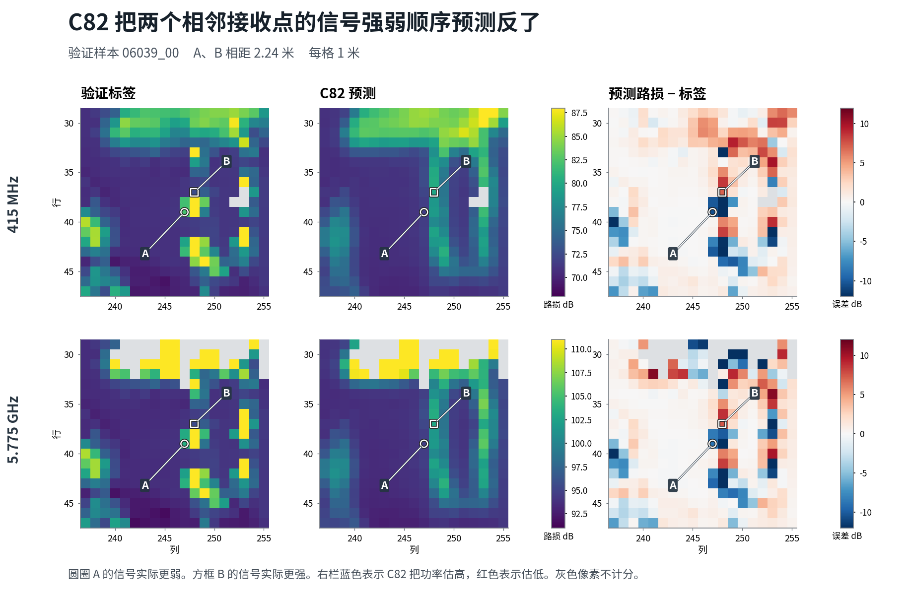

# C82 在官方验证集上为什么误差大

C82 在 680 块地形、每个频段 2,330 张完整官方验证图上的 RMSE 为 **2.2464 / 2.5791 dB**，官方脚本综合值为 **2.412764 dB**。下文频段顺序固定为 415 MHz、5.775 GHz。本轮只读取冻结预测并分析，没有训练、更新权重或提交网站。

**总分主要被两类点拉高。通视区有少量局部功率跌落，C82 常漏掉弱点的位置，也低估跌落的深度。遮挡区中，高频相对低频的额外损失随位置明显变化，C82 能预测平均值，仍有较大的逐像素误差。**

## 误差落在哪里

每个频段按自己的有效掩码计分，有效像素共 151,537,682 / 135,926,253 个。这次在所有验证像素上重新生成 C82 沿用的几何可见率。固定抽样的 4,771,840 个位置与此前缓存逐值一致。下表每列的误差占比，分母都是该频段完整验证集的平方误差和。

| 候选几何状态 | 有效像素占比 | 组内 RMSE，dB | 占总平方误差 |
|---|---:|---:|---:|
| 全可见，接收单元加权可见率大于 99% | 72.62% / 80.97% | 1.774 / 1.864 | **45.31% / 42.28%** |
| 部分遮挡，可见率 1% 至 99% | 1.80% / 1.99% | **4.077 / 5.844** | 5.92% / 10.21% |
| 遮挡，可见率低于 1% | 25.58% / 17.04% | 3.101 / 4.306 | **48.77% / 47.51%** |

部分遮挡的单点误差最大。即使把边界拓宽到部分遮挡像素或相邻可见状态分界线周围 2 米，也只覆盖 **19.36% / 32.47%** 的总平方误差。距离边界超过 2 米的遮挡内部仍占 **39.90% / 30.36%**。这是候选地形的几何分区，官方没有发布逐像素遮挡真值。

**误差高度集中。** 绝对误差至少 5 dB 的点占有效像素 **4.20% / 5.26%**，占总平方误差 **76.30% / 78.27%**。将门槛提高到 10 dB，还有 **1.04% / 1.39%** 的点，占 **45.87% / 49.93%** 的总平方误差。约半数像素的绝对误差只有 0.3 / 0.4 dB。预测功率过强这一方向占总平方误差的 **66.22% / 64.67%**，它与大量反向小偏差抵消，所以平均误差接近零。

## 全可见区同时有位置错误和幅度错误

对每张验证图预先均匀抽取 2,048 个位置，再应用各频段掩码。全可见区分别包含 3,439,024 和 3,439,381 个有效位置。以候选收发坐标范围内最远的距离计算保守直达参考。标签总功率比该参考弱逾 3 dB，定义为弱点。以相同的标准检查 C82 的预测。

| 全可见区抽样 | 415 MHz | 5.775 GHz |
|---|---:|---:|
| 弱点占该区有效像素 | 4.76% | 4.21% |
| 弱点占该区平方误差 | **72.80%** | **72.45%** |
| C82 检出的真实弱点比例 | **52.21%** | **52.69%** |
| C82 预测为弱点的位置中，实际为弱点的比例 | 49.20% | 48.53% |
| 在模型和标签均判为弱点的位置，预测功率平均高出多少 | **4.17 dB** | **4.59 dB** |

仅“位置找对、幅度仍错”的弱点，就占全可见区平方误差的 **47.92% / 49.01%**。在能够保守确认整个接收单元通视的候选几何范围内，召回率进一步降到 **39.97% / 37.90%**。按地形重采样，95% 区间分别为 38.0%–41.8% 和 35.7%–40.0%。

掠射方向仍能标出容易出错的一带。在同一张验证图及同一发射机内，匹配传播距离和估计的反射、散射强度后，掠射采样权重超过 50% 的一组，真实弱点率为 **18.52% / 14.98%**。该权重低于 5% 的一组，弱点率为 **0.27% / 0.23%**。这个规律有助于定位风险区域，尚不能确定每个米级像素的功率。

在原全可见点上，至少一种合理候选几何将可见率降至 90% 以下的点，包含该区 **35.26% / 40.10%** 的平方误差。其余大部分误差仍落在多种设定都判为可见的地方。把此前仅在官方 TRAIN 拟合的反射和漫散射校正原样应用于 C82，相对同一几何校正，全可见区 RMSE 只额外下降 **0.00068 / 0.00085 dB**。这衡量的是已有一次反射近似能转移到 C82 的增益。发布的总路损标签不足以还原每条路径的真实功率。

## 遮挡区的双频差异

只比较两个频段共同有效的像素。定义双频差为高频路损减低频路损，再扣除自由空间频率差 22.87 dB。

| 区域 | 两频段带符号预测误差的相关系数 | 双频差的逐像素 RMSE |
|---|---:|---:|
| 全可见 | **0.972** | 0.436 dB |
| 部分遮挡 | 0.845 | 3.235 dB |
| 遮挡 | **0.217** | **4.660 dB** |

在 23,026,413 个双频共同有效的遮挡像素上，标签的双频差平均为 **22.14 dB**，C82 为 **22.16 dB**。预测与标签的双频差相关系数仍有 0.896，但标签的标准差为 10.49 dB，预测仅为 9.36 dB。模型学到了高频损失的大体分布，局部双频差的幅度和位置仍有误差。验证图 01458_00 的接收点（60，153）位于遮挡内部。低频标签 / 预测为 81.38 / 81.73 dB，只差 0.36 dB。高频对应为 147.75 / 136.74 dB，模型把接收功率估高了 **11.01 dB**。

## 验证图上的一个反例

验证样本 06039_00，发射机位于（100，52）。下面两个像素相距 2.24 米，在重建的几何范围内均可保守确认通视。该地形的双频综合 RMSE 为 2.367 dB，处于 680 块地形的中间一半。

| 接收点（行，列） | 415 MHz 标签 → C82 | 5.775 GHz 标签 → C82 | 结果 |
|---|---:|---:|---|
| A（39，247） | 82.19 → 71.63 dB | 103.44 → 94.62 dB | 真实弱点，预测功率高出 10.56 / 8.82 dB |
| B（37，248） | 72.69 → 79.79 dB | 95.50 → 102.99 dB | 预测为弱点，功率低估 7.10 / 7.49 dB |

左列和中列的颜色表示路损，数值越高，接收功率越弱。图中灰色为掩码排除的像素。这个例子用于展示错误形态，发生率以前面的全验证统计为准。同图、双频有效、保守通视、距离不超过 12 格且同时达到预定误判门槛的相反误差点对，在固定抽样里共有 273 对，分布在 192 张图和 85 块地形上。

## 哪些解释能排除到什么程度

- **全图标定偏差很小。** 预测路损减标签的均值只有 −0.0014 / +0.0035 dB。即使事后知道每张图的真实平均偏差并扣除，完整验证 RMSE 也只变为 2.2449 / 2.5723 dB。
- **统一平移没有收益。** 每张图在行列各 ±2 像素的整数位移中选择误差最小的位移。用棋盘格一半有效点选择，在另一半计分，再交换两半。两频段全部 2,330 张图都选零位移。允许每个 8×8 小块单独选择位移，可降低 0.070 / 0.138 dB。再允许每块用标签估计一个功率偏差，可降低 0.171 / 0.276 dB。这些参数借用了验证标签，仅用于诊断。为保证同一支持域，这组比较都排除了 2 像素图边，各自基线为 2.209 / 2.539 dB。
- **多数大误差在附近也找不到合适的预测幅度。** 对绝对误差至少 5 dB 的内部像素，即便用该点真值从 5×5 邻域任选最接近的预测，只有 **37.95% / 30.25%** 能回到 1 dB 以内。4×4 块内细节占完整验证平方误差的 **71.07% / 67.56%**。预测细节的起伏幅度只有标签的 69.34% / 76.01%，但用真值求得的最佳全局细节乘数仍为 0.997 / 0.999。只放大纹理不会解决弱点位置错误。
- **误差遍及验证集。** 按每块地形的双频平均 RMSE 排序，剔除最差 10% 的地形，余下地形仍为 2.181 / 2.535 dB。只有 10/680 块地形两个频段都不高于 1 dB。距发射机不到 50 米的点，RMSE 为 1.091 / 1.107 dB，200 米及更远处为 3.041 / 3.360 dB。距离和传播状态会共同变化，这组距离统计不能单独证明因果。
- **补洞边缘有影响。** 距同频段无效像素不超过 2 米的有效点占 1.66% / 3.54%，占总平方误差 10.93% / 17.38%。高频有效标签恰为 145 dB 的位置只占高频平方误差的 0.13%。主计分已排除掩码标记为无效的点。

此次定位到的两个难点是通视弱点的位置和深度，以及遮挡区的双频差。它们说明下一种方法需要改进哪些预测。要把错因进一步分到原始地形网格、接收单元射线命中或单元到像素的插值，还需要插值前的官方记录。本轮未利用官方验证标签选择或训练新模型。

[分组数值、地形区间和对照分母](../audit/c87_val/summary.json) · [680 块地形明细](../audit/c87_val/terrains.json) · [验证图实例坐标](../audit/c87_val/examples.json)
